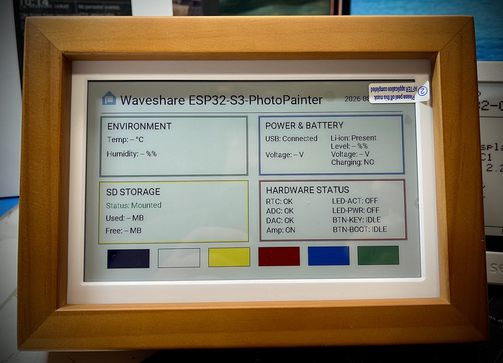

# ESPHome for the Waveshare ESP32-S3 PhotoPainter

A reusable ESPHome package for the
[Waveshare ESP32-S3 PhotoPainter](https://www.waveshare.com/wiki/ESP32-S3-PhotoPainter)
(Rev 2.0) and its 7.3-inch Spectra E6 e-paper display: 800 x 480, six colours.
Include the package from your own device configuration and you get the whole
board: display, safe rail control, battery and USB telemetry, RTC,
temperature and humidity, SD card, speaker, microphone, buttons, and LEDs.

The package rests on a hardware investigation of the board, recorded in
[HARDWARE.md](HARDWARE.md). Those findings were verified on a physical unit and
do not depend on ESPHome. Anyone writing other firmware for this board can use
them as source material; they are also the basis for PhotoPainter board support
being developed separately for the [OpenDisplay](https://opendisplay.org)
firmware.



*The status dashboard on the development unit, showing the six-colour panel
output.*

## Quick start

Create a device configuration that includes the package and supplies your own
identity and credentials:

```yaml
packages:
  photopainter: github://edennelson/Waveshare-ESP32-S3-PhotoPainter/packages/waveshare-esp32-s3-photopainter.yaml@v1.0.0

esphome:
  name: office-photopainter
  friendly_name: Office PhotoPainter
  area: Office

wifi:
  ssid: !secret wifi_ssid
  password: !secret wifi_password

api:
  encryption:
    key: !secret api_encryption_key

ota:
  - platform: esphome
    encryption:
```

Install over USB the first time. `ota: encryption:` reuses the API key to
encrypt over-the-air updates; it needs ESPHome 2026.9 or newer, which is also
the package's minimum. The `@v1.0.0` suffix pins a release tag; a
commit SHA works as well.

The package builds with the ESP-IDF framework. The first build needs network
access, because the dashboard fonts come from Google Fonts through ESPHome.

### Choose an entry point

| Entry point | What you get |
| --- | --- |
| [`waveshare-esp32-s3-photopainter.yaml`](packages/waveshare-esp32-s3-photopainter.yaml) | The board: hardware, SD storage, entities, safe audio/display/PMIC controls, and I2C recovery. No credentials, display layout, or application behaviour. Start here for your own project. |
| [`waveshare-esp32-s3-photopainter-demo.yaml`](packages/waveshare-esp32-s3-photopainter-demo.yaml) | The board plus a six-colour status dashboard, a Waveshare pre-dithered sample image (selectable, or rotated with the dashboard), RTTTL test tune, SD voice-note recording and playback, and manual deep sleep. |
| [`waveshare-esp32-s3-photopainter-diagnostic.yaml`](packages/waveshare-esp32-s3-photopainter-diagnostic.yaml) | The board plus DEBUG logging, runtime diagnostic state, and read-only register snapshots. Use it when reporting a problem. |
| [`waveshare-esp32-s3-photopainter-battery.yaml`](packages/waveshare-esp32-s3-photopainter-battery.yaml) | The board plus slower polling and idle logical audio shutdown. Battery-oriented, not a measured low-power result. |

**Optional web UI grouping.** If your device runs `web_server:`, also include
[`waveshare-esp32-s3-photopainter-web-ui.yaml`](packages/waveshare-esp32-s3-photopainter-web-ui.yaml),
plus `-web-ui-demo.yaml` and `-web-ui-diagnostic.yaml` for each of those layers
you use. They switch the web UI to version 3, serve its script from the firmware
(`local: true`) rather than ESPHome's CDN, and group entities into Display,
Power, Deep Sleep, Audio, Voice Notes, Storage, Environment, Buttons & LEDs, and
Diagnostics. Leave them out if you do not run the web server: ESPHome rejects
entity grouping on a device without one.

### What stays in your configuration

The package owns the board, and your configuration owns the installation. Device
identity, Wi-Fi, API encryption, OTA, fallback access point, and other site
policy belong to you. ESPHome merges your `esphome:`, `wifi:`, `api:`, and other
stanzas with the package's, so you do not copy the package or route secrets
through substitutions. Components meant for customization carry stable IDs, so
you can `!extend` or `!remove` them.

[ESPHome/README.md](ESPHome/README.md) has the full merge and ownership contract,
and [`examples/`](examples/) has a small consumer for each entry point.

### Standalone profiles

If you would rather have one complete file than a package, two rendered profiles
are available:

| Profile | Use it for |
| --- | --- |
| [`WaveshareESP32S3PhotoPainter73e6-example.yaml`](ESPHome/WaveshareESP32S3PhotoPainter73e6-example.yaml) | The demo composition: dashboard, test tune, voice notes, and manual deep sleep. `INFO` logging. |
| [`WaveshareESP32S3PhotoPainter73e6-diag.yaml`](ESPHome/WaveshareESP32S3PhotoPainter73e6-diag.yaml) | The same, plus `DEBUG` runtime reporting and read-only PMIC, RTC, and codec register snapshots. |

Both are generated from the package by
[`generate_esphome_profiles.py`](scripts/generate_esphome_profiles.py), so they
cannot drift from it. Paste one into the ESPHome dashboard and add
`wifi_ssid`, `wifi_password`, `api_encryption_key`, `fallback_password`, and
`web_server_password` to your `secrets.yaml`. Use an ESPHome-generated API key,
a fallback password of at least eight characters, and a strong, unique web
password (the web UI logs in as `photopainter-admin`).

> [!WARNING]
> **Do not hold the PWR button for 6 seconds or longer.** That is the AXP2101's
> own hardware power-off: it de-energizes ALDO3 and leaves the shared I2C bus clamped, so the
> board needs a full power drain (USB and battery out for at least a minute). A
> short press is harmless. Firmware cannot block it; the log records every PWR
> press and how long it was held.

> [!NOTE]
> "PhotoPainter Restart" reboots the ESP32 only and leaves every PMIC rail on.
> There is deliberately no PMIC power-off or PMIC restart: both de-energize ALDO3,
> which clamps the shared I2C bus until the board is fully drained of power for at
> least a minute.

## Status

The 1.0.0 release is gated on a physical regression run of the package-built
images. Release candidates identify themselves as `1.0.0-rc.N` in the boot log.

- **Hardware behaviour is settled.** Every power rail and every register this
  package touches has been identified and verified on a physical Rev 2.0 unit.
  [HARDWARE.md](HARDWARE.md#settled) lists what is closed.
- **All of the board's hardware has been demonstrated working** with ESPHome.
  The package splits that proven implementation into reusable layers.
- **Package builds** validate and compile for every entry point with ESPHome
  2026.10.2 (2026-11-13). Physical regression of the package-built images, including the
  demo's deep-sleep and wake path, is the remaining gate for 1.0.0.
- **First current measurements are recorded** (2026-11-14, USB-C at 5.0 V):
  [PPK2 run 1](Measurements/2026-11-14_ppk2-run1-usbc-5v0/README.md). Idle with
  everything on is about 120 mA at 5 V, audio logical shutdown saves about 56 mA,
  and deep sleep is about 16 mA. Switching the display rail off while awake
  currently *raises* current (under investigation). These are one board and one
  supply; the battery-input run is still to do.

Not yet built or characterized:

- Current consumption on battery input, and without monitoring clients connected
- Repeat-cycle regression across the power-state matrix
- Battery ADC enable behaviour across the power-state matrix
- Native `image:` dithering against Waveshare's 480 x 480 sample image
- The PWR button and AXP2101 interrupt path

## The one thing that makes this board different

**ALDO3 must be on before anything touches I2C, and this package keeps it on.**
While it is off, the entire shared I2C bus is unusable, not just audio.

ALDO3 is the audio rail. It supplies the ES8311 codec and ES7210 ADC, and those
two chips share the I2C bus with the AXP2101 PMIC, the PCF85063 RTC, and the
SHTC3 sensor. When ALDO3 is de-energized, the codecs' I2C pins lose their supply
and their ESD/input-protection diodes clamp SDA and SCL to the dead rail. The
bus stops working for every device on it, including the PMIC that would have to
turn ALDO3 back on. Nothing in software recovers it; only a full power drain
does.

This package needs the bus after boot, for PMIC telemetry, the RTC, the SHTC3,
codec status, and switching the display rail. So:

- **ALDO3 is never disabled.** The package enables it during PMIC bring-up,
  before any component initializes, and leaves it on.
- **Audio is quieted logically, not by rail.** The "Audio: Codecs Enabled"
  switch puts the ES8311 and ES7210 into their documented low-power register
  states and disables the NS4150B amplifier on GPIO7. The bus stays healthy and
  the change is fully reversible. That it saves meaningful power is a data-sheet
  inference, not a measurement.
- **ALDO4, the display rail, is safe to cycle.** It is not on the shared bus. The
  "Display: Enabled" switch powers the panel down at a safe point and back up
  cleanly.

Firmware that never touches the shared bus after boot can go further, dropping
rails and placing components in their documented low-power states. None of that
is supported or tested here, but the rail map and register tables in
[HARDWARE.md](HARDWARE.md) are the place to start.

## Seeing `i2c.master: I2C software timeout`? Your configuration is fine

If the log fills with I2C timeouts right after flashing, the YAML is not broken.
The bus was left clamped by whatever ran on the board before. Any firmware that
powers down with ALDO3 disabled leaves it that way; as of 2026-08-31 OpenDisplay
does. A reflash does not clear it, because reflashing neither de-energizes the
rail nor drains the board.

**The fix is a full power drain:**

1. Disconnect USB-C **and** unplug the battery. Either one alone keeps the board
   alive.
2. Leave it disconnected for **at least one minute.** The bulk capacitance needs
   time to drain; ten seconds is reliably not enough.
3. Reconnect power. The package enables ALDO3 during PMIC bring-up, so the bus
   comes up clean and stays that way.

Once you are running this package you should not need to do this again. It never
disables ALDO3, and no switch it exposes can put the board into that state.

## Hardware coverage

| Subsystem | Device or interface | Demonstrated |
| --- | --- | --- |
| Main controller | ESP32-S3, 16 MB flash, octal PSRAM | ESP-IDF ESPHome build, Wi-Fi, API, OTA, and web server |
| Display | 7.3-inch Spectra E6 e-paper | Six-colour 800 x 480 dashboard |
| Power management | AXP2101 at I2C `0x34` | Early boot initialization, rail register diagnostics, USB/battery presence, charging, voltage, and battery percentage |
| Power control | AXP2101 rails and codec registers | Live display rail (ALDO4) on/off, logical audio shutdown and restart, ESP32 restart, and demo ESP32 deep sleep with BOOT, KEY, or timer wake |
| Bus resilience | Shared I2C (SDA 47 / SCL 48) | Bounded ESP-IDF bus-reset recovery with independent PMIC and RTC verification, retried every 15 s while the bus is down |
| Environment | SHTC3 at I2C `0x70` | Temperature and humidity |
| RTC | PCF85063 at I2C `0x51` | Hardware time, oscillator status, and SNTP synchronization |
| Audio output | ES8311 plus NS4150B | I2S speaker, media player, volume control, and RTTTL playback |
| Audio input | ES7210 | I2S microphone and five-second WAV recording |
| Storage | microSD/TF card | Mounting, capacity reporting, and voice-note storage/playback. The mount never formats a card. |
| Inputs | BOOT, KEY, and PWR buttons | ESPHome binary sensors; in the demo, KEY plays the test tune. PWR is monitored (read-only), never acted on |
| Indicators | ACT and PWR LEDs | Individually controllable ESPHome lights and dashboard status |

The full GPIO map, including the two pins the package deliberately leaves
unclaimed, is in [HARDWARE.md](HARDWARE.md#gpio-map).

## Security

Follow ESPHome's [security best practices](https://esphome.io/guides/security_best_practices/).
The examples and standalone profiles here already:

- encrypt the native API, and encrypt OTA updates with the same key;
- require a login for the web UI, which can restart the device and switch rails;
- do not enable firmware upload through the web page (`ota: platform:
  web_server`);
- set a fallback access-point password. A device in production can drop the
  `ap:` section entirely;
- keep the Wi-Fi log tag at INFO, even in the DEBUG diagnostic layer, so
  credentials cannot reach a captured log.

Give every device its own API key and web password, and keep the board on a
trusted, segmented network. Remote package files contain no secrets; they live
only in your local `secrets.yaml`.

## Reporting behaviour

Use the diagnostic entry point and attach the full log from reset through the
first display refresh, including the
`Project edennelson.waveshare-esp32s3-photopainter version` line. "Reboot" alone
does not distinguish the power states involved here; the boot line
`photopainter_power event=power_reason` states which one actually happened.

**USB serial and USB power are the same cable**, so a test that removes USB-C
removes the logger at the instant being measured. Capture anything power-related
over the network instead:

```text
esphome logs <your-config>.yaml --device OTA
```

The board keeps running from whichever source remains, so the connection
survives the transition. Serial is right for a boot capture, because Wi-Fi is not
associated for the first few seconds. [TESTING.md](TESTING.md) has the full
procedure and the log vocabulary.

## Repository layout

| Path | Purpose |
| --- | --- |
| [`packages/`](packages/) | The ESPHome package: public entry points and their modular implementation. |
| [`examples/`](examples/) | Small package consumers, used for validation and as starting points. |
| [`ESPHome/`](ESPHome/) | Package design contract and the generated standalone profiles. |
| [`HARDWARE.md`](HARDWARE.md) | Rail map, GPIO map, PMIC register table, measured timings, and the evidence behind them. |
| [`TESTING.md`](TESTING.md) | How to capture a log that means something, the log vocabulary, and the procedures with a known-good result. |
| [`CHANGELOG.md`](CHANGELOG.md) | What each release changed, matched to the version in the boot log. |
| [`Logs/`](Logs/) | Sanitized device logs from bring-up and the power-state matrix. |
| [`Measurements/`](Measurements/) | PPK2 current measurements: run header, results, boundary log lines, and a 1 s trace. |
| [`scripts/`](scripts/) | Package verification and standalone-profile generation. |
| [`Documentation/README.md`](Documentation/README.md) | Provenance, authoritative sources, and hashes for third-party PDFs. |
| [`References/README.md`](References/README.md) | Pinned vendor repositories and immutable links to the relevant source files. |

To validate and compile every example consumer locally, run
`scripts/verify_esphome_packages.sh`, or add `--config-only` for validation and
include checks only. See [package verification](TESTING.md#package-build-verification).

## Sources and licence

The primary hardware references are:

- [Waveshare ESP32-S3 PhotoPainter wiki](https://www.waveshare.com/wiki/ESP32-S3-PhotoPainter)
- [Waveshare ESP32-S3 PhotoPainter vendor repository](https://github.com/waveshareteam/ESP32-S3-PhotoPainter)
- The document manifest in [`Documentation/README.md`](Documentation/README.md)
- The immutable source map in [`References/README.md`](References/README.md)

The vendor demo, factory firmware, sample bitmaps, and data sheets are not
republished here. The manifests above carry exact hashes and immutable upstream
links for fetching and verifying them from their authoritative homes, and they
remain subject to their original licences.

The original work in this repository is licensed under [GPL-3.0](LICENSE).
